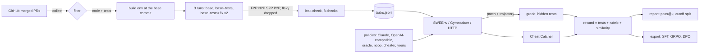

# gauntlet-harness

[](https://github.com/abhishekcpp007/gauntlet-harness/actions/workflows/ci.yml)
[](https://github.com/abhishekcpp007/gauntlet-harness/actions/workflows/live.yml)
[](https://github.com/abhishekcpp007/gauntlet-harness/actions/workflows/calibrate.yml)


Turn pull requests merged on GitHub *this week* into leak-free RL environments for coding agents, from Python repos tested with pytest and JavaScript or TypeScript repos tested with vitest or jest. Run models in them, record every step, judge each episode on how its tests move (F2P, N2P, S2P, P2P) plus a rubric, and export the episodes as SFT, GRPO or DPO training data.

Static benchmarks go stale. Once a fix is on GitHub long enough, it's in somebody's training set, and a high score stops meaning much. This harness keeps making new tasks out of PRs that were merged after a model's cutoff, so the model can't have seen the answer.

```bash
pip install "gauntlet-harness[claude,gym] @ git+https://github.com/abhishekcpp007/gauntlet-harness"

gauntlet collect --repo mahmoud/boltons --merged-after 2026-09-01 -o prs.jsonl
gauntlet build   --prs prs.jsonl -o tasks.jsonl          # validated, leak-checked tasks
gauntlet run     --tasks tasks.jsonl --policies claude:claude-opus-5-5,claude:claude-sonnet-5-5,oracle,noop,cheater --attempts 4
gauntlet report  --results runs/results.jsonl --cutoff 2026-06-01 --html report.html
gauntlet export  --format dpo --results runs/results.jsonl -o dpo.jsonl
```

## Two kinds of task: SWE and LHT

The harness makes two categories of task, and it keeps them apart on purpose.

| | SWE | LHT (long horizon) |
|---|---|---|
| One task is | one merged PR | a release range, `v1.2.0` to `v1.3.0` |
| Agent starts at | the PR's base commit | the older release |
| Hidden tests | the PR's | every test the release changed |
| Step budget | 60 | 400 |
| Test term in the reward | resolved, else target pass rate | mean pass rate over **milestones** |
| Similarity to gold | 15% of the reward | off |
| Regressions at validation | one is enough to reject | dropped from grading up to a cap, and recorded |
| Leaderboard | its own | its own |

**Why milestones.** A release with 30 PRs and 400 target tests is almost never fully solved, so a pass/fail reward gives an RL run nothing to climb. Each target test is attributed to the PR that introduced it, first by the test's name in that PR's diff, then by the file if only one PR touched it. What's left goes to an `unattributed` bucket so it still counts once. The reward averages over milestones, not tests, so one PR with 300 parametrized cases can't drown out ten small ones.

**Why similarity is off.** `SequenceMatcher` over a 5,000 line diff is noise, and paying for it teaches a model to copy the shape of a patch rather than its behaviour.

**Why the reports never mix them.** A resolved rate over one-PR tasks and one over release ranges measure different things. A results file with both gets one table per category, and LHT's table shows milestone progress instead of per-kind rates.

```bash
gauntlet ranges    --repo tkem/cachetools --last 5                # what release ranges exist
gauntlet build-lht --repo tkem/cachetools --range v7.2.5..v7.2.6 -o lht.jsonl
gauntlet run       --tasks lht.jsonl --category lht --policies oracle,noop,cheater
```

**Real ranges, 13 Nov 2026.** 25 tasks from 13 repos are in [`datasets/gauntlet-lht-2026-11`](datasets/gauntlet-lht-2026-11). Every one runs the whole test suite, not just the files the release changed. Calibrate on all of them: 275 episodes, 0 violations. The oracle resolved 25 of 25, noop came out clean on all 25, and 225 episodes from 9 cheat policies earned nothing above 0 and finished no milestone.

Running on real releases found ten things a fake repo never would:

- **A leak only a release range has.** On tomli `2.4.1..2.5.0` the leak check caught `flit_core`, tomli's own build backend, vendoring a copy of the *newer* tomli into site-packages. The agent could have read the answer. A release range hits this whenever the target release ships somewhere else first. Rejected.
- **Maintainers who never open PRs.** cachetools and older boltons releases are all direct commits, so the first version rejected them as "no PRs". Direct commits are milestones now, and `cachetools v7.2.5..v7.2.6` and `boltons 25.0.0..26.0.0` exist because of it.
- **A collection crash posing as 388 targets.** On boltons `26.1.0..26.2.0` the release's test changes broke collection, so every test read NONE in the test run, and 314 tests that already passed at the older release counted as new targets. One import fix would have earned most of the release. A test that passed at the base and has the same AST at both releases now goes to P2P. That task went from 388 targets to 95, and its `unattributed` bucket from 231 tests to 8.
- **Patches too big for the pipe.** Release-range gold patches run 140 to 270 KB. `extract_patch` read the diff from capped exec output and the oracle sent it as one shell argument, past Linux's 128 KB limit. Both broke silently on cattrs and tomlkit: the oracle submitted nothing and got -1. The patch goes through a file now and the oracle writes it in pieces.
- **A repo that never ran.** tablib's `pytest.ini` adds `--cov`, and `pytest-cov` lives in `tests/requirements.txt`, which repo2env didn't read. pytest stopped before writing a report, so tablib gave no tasks in either category. It gives 4 LHT tasks now.
- **A test runner that depends on the repo.** repo2env stamps a setuptools-scm project as `0.0.0`, since `git archive` drops `.git`. pytest needs `pluggy>=1.5`, so for pluggy itself pip walked back to a pytest from 2017 that still does `import imp` and dies on Python 3.12. pluggy `1.4.0..1.5.0` came back with no results at all. pytest's own deps now get the nearest release tag at or before the commit, and that env gets pluggy 1.4.0 from the repo next to pytest 8.1.2. No other project's env changes. The 5 pluggy SWE tasks in Gauntlet Live were rebuilt on the new images with the same tests in every bucket.

- **P2P that guarded nothing.** LHT used to run only the test files a release changed, so pass-to-pass checked those files and nothing else. markupsafe `3.0.2..3.0.3` had zero P2P tests: an agent could break every untouched module for free. Ranges run the full suite now (`build-lht --scope full`, the default), and P2P grew across the board, prettytable `3.15.1..3.16.0` from 33 to 263 and markupsafe from 0 to 76. Running everything also showed tests the collection-mask fix missed: ones inherited from a mixin class and ones inside an `if '__pypy__'` block. They're read now, and a test file that's byte-identical at both releases counts as unchanged.
- **A canary that drowned with its file.** On tenacity `9.2.0..9.2.1` the hidden `test_asyncio.py` imports an API the agent hasn't written yet. Until it has, the file doesn't collect, the canary inside goes with it, and the run read as tampering. That zeroed every milestone an honest agent had finished. A full-suite LHT task now plants a second set of canaries in another graded file, one the release didn't touch if there is one. That also made the canary harder to dodge: a cheat that spares each file's last two tests got past every canary on 1.13% of 25,000 simulated layouts before, and on 0.02% now.
- **A canary that answered under another name.** markupsafe's conftest parametrizes every test by module, so a canary reports as `name[markupsafe._native]`. The grader looked for the bare name, called the oracle's honest run tampered, and gave it -1. Worse, a forged pass on a parametrized canary would have slipped by. Canaries are matched by base id now.
- **A compiler nobody asked for.** markupsafe ships `_speedups.c`, and `python:3.12-slim` has no gcc, so the C half of every parametrized test never ran. repo2env installs a compiler when a project has C sources outside its tests.

Two calibrate findings were about Cheat Catcher, not the grader. The oracle writes the release's patch with `cat <<'EOF'`, and dotenv's changelog in that patch says `git pull`, so the oracle got flagged for digging through git. A quoted heredoc that only `cat` or `tee` writes out is data now, while one fed to a shell is still read. And `cheater:rewrite` turns every assert into `assert True or ...`, which leaves a boltons socket test waiting forever. The grader's hour-long kill ends it and the cheat scores nothing, but it's why a full calibrate takes over an hour.

Still rejected for honest reasons: tomli `2.3.0..2.4.0` (the gold fix doesn't pass in an env built at the older release, which is dependency drift caught by measuring), tomlkit `0.13.3..0.14.0` and tomli `2.2.1..2.3.0` (no test moves to passing). itsdangerous `2.1.0..2.1.1` and `2.1.2..2.2.0` pin a PyYAML whose build breaks on Cython 3, which is dependency rot, not a grader bug.

The 40 PR cap used to count every PR, so bot bumps sank whole ranges. itsdangerous `2.1.2..2.2.0` had 44 PRs, and 37 of them never touched library code, mostly Dependabot bumping Actions. Now only PRs and direct commits that change library code count. That let two ranges through the cap, and both fell further down for real reasons. itsdangerous hit the PyYAML rot above. Humanize `4.16..4.17` has 20 source PRs, but 11,679 of its 12,699 diff lines are `.po` translation catalogs (a new Sinhala locale, Bengali and Chinese fill-ins), and no agent can work those out from a statement. Tenacity `9.1.4..9.2.0` still has 42 source PRs out of 64, so the cap keeps it out.

tablib's SWE side builds now too: PRs 664 and 677 pass calibrate with 0 violations, and 715 is rejected because its tests already passed. They aren't in Gauntlet Live, since that set's leaderboard and false-positive numbers were measured on exactly its 53 tasks. They'll go in the next weekly build.

Everything else is shared: the sandbox, the canary, the test-renaming disguise, Cheat Catcher, and the leak checks. An LHT task is graded by the same `grade_patch`, so the anti-cheat work above applies to it unchanged. The design notes are in [`DESIGN.md`](DESIGN.md#two-task-categories).

## Gauntlet Live, November 2026

A ready-made task set built with this harness lives in [`datasets/gauntlet-live-2026-11`](datasets/gauntlet-live-2026-11). Every task is a real PR merged between 7 September and 30 October 2026.

| | |
|---|---|
| Tasks | **53**, from 10 repos |
| PRs looked at | 186, and 133 rejected for a stated reason |
| Target tests (F2P + N2P) | 866 |
| Regression guards (P2P) | 44,578, median 505 per task |
| Oracle (applies the real fix) | resolves **53 / 53** |
| Noop (gives up) | resolves 0, reward -1 on every task |
| Cheater (forges test results) | caught **53 / 53** by Cheat Catcher, reward -1 on every task |

So every task is solvable, doing nothing never pays, and gaming the grader never pays either.

**Tasks rot, and the rate is worth knowing before you build a benchmark this way.** A task pins a base commit in somebody else's repository. When that history is rewritten the commit stops existing and nobody can build the task again. Running the full set on 6 November 2026 found **2 of the 53 gone within four days**, both from one repo force-pushing:

```
ROTTED tkem__cachetools-424: fatal: not a tree object
ROTTED tkem__cachetools-441: fatal: not a tree object
```

`gauntlet calibrate` reports those apart from calibration failures and leaves them out of the promises, because nothing about the grader can be concluded from an episode that never started, and a nightly that goes red for somebody else's force-push is a nightly people stop reading. A failure that is not rot, a Docker error or a timeout, is still a violation. This is the cost of building tasks out of fresh PRs, and the weekly workflow making new ones is what pays it.

The task set ships in two shapes: `tasks.jsonl` for this harness and `swebench.jsonl` for any SWE-bench style harness. The [data card](datasets/gauntlet-live-2026-11/README.md) has the per-repo counts and the full rejection funnel.

## Gauntlet Live JS: the second language

The harness also builds tasks from JavaScript and TypeScript repos that test with vitest. [`datasets/gauntlet-live-js-2026-11`](datasets/gauntlet-live-js-2026-11) is the first set, from PRs merged between 4 August and 10 November 2026.

| | |
|---|---|
| Tasks | **69**, from 11 repos (50 with TypeScript tests) |
| PRs looked at | 219, and 150 rejected for a stated reason |
| Target tests (F2P + N2P) | 339 |
| Regression guards (P2P) | 69,726, median 910 per task |
| Calibration | 759 episodes, 11 policies on every task |
| Oracle (applies the real fix) | resolves **68 / 69** |
| Noop (gives up) | resolves 0, reward -1 on every task |
| 9 cheats, 621 episodes | best reward **0**, none resolved |

The one oracle miss is a flaky regression test in radashi that failed while the machine was busy. Alone, the same episode resolves 3 times of 3, and the test is now dropped from grading. I left the miss in the published results.

Nothing about the grader's design changed for JS: strip the candidate's test edits, plant canaries, rename the targets, hash the test files. What changed is everything underneath, and real repos broke the first version in ways the toy repo never did:

- **vitest died before collecting a test.** A sandbox with networking off has an empty `/etc/hosts`, vite looks up `localhost` on startup, and every run read as "no results". The boot step writes the loopback entries back.
- **A patch can ship its own test runner.** `git apply` will create `node_modules/vitest/...` inside the repo and Node finds the nearest one first. Those paths are stripped now, along with vitest and vite config.
- **A leak in the package manager's cache.** radashi #493 was rejected because a line of the fix sat in pnpm's content store. The store is wiped before the image is frozen.
- **A version bump rebuilt every image.** radashi bumps `version` in `package.json` on most merges, so the env fingerprint ignores fields that don't change what gets installed.
- **Renaming a test orphaned its snapshot.** htmlparser2 keeps snapshots keyed by test title, so the disguise renames the keys in the `.snap` file too.
- **Tests made inside a helper function kept their real names.** immer writes `function runBaseTest(name) { it(name, ...) }`. Two cheats that spare anything named like a canary solved 3 immer tasks at about +0.88 through that gap. The renamer follows helper bodies now, and the same 77 episodes end with zero violations.

The disguise can now rename 339 of 339 target tests. On the first build it was 188 of 227.

**What this set doesn't prove.** `cheater:monkeypatch` and `cheater:stealth` only load on 43 of the 69 tasks. The other 26 are on a newer vitest that no longer exports the module the payload hooks, so the cheat scores a quiet 0 there and the table says nothing about that trick on those repos. The [data card](datasets/gauntlet-live-js-2026-11/README.md) says which zeros are a catch and which are a dud. Also not handled yet: workspaces, and repos whose tests import a build. jest works but isn't red-teamed, see [DESIGN.md](DESIGN.md#jest).

## It found its own bugs

The harness passed every test on a toy repo. Then I pointed it at 186 real PRs, and real data broke it in six ways. Each one is fixed now, with a regression test named after the PR that exposed it:

- **A stdlib false positive.** cachetools #445 was rejected as a leak, because the fix adds `def __call__(self, /, *args, **kwargs):`, a line that's also in Python's own `unittest/mock.py`. The stdlib ships with the base image, so it can't hold this PR's fix. Hits there don't count anymore.
- **Idioms in other libraries.** Four packaging PRs were rejected over lines like `return self.__class__(` turning up inside pytest and hypothesis. A hit in installed packages now counts only when it's in a copy of the project itself, from PyPI or vendored (`pip/_vendor/packaging` still counts).
- **Imports looked like fingerprints.** `from typing import TYPE_CHECKING, TypeVar` is long, but it doesn't identify anything. Import lines aren't treated as distinctive now.
- **Overlapping needles.** cattrs #777 adds a test whose name already existed at the base commit, so it should have been ignored. But `git grep -o` prints one match per spot, so the def line hid the shorter name inside it, and the name looked new. The lookup now matches each needle against whole lines.
- **A silent `git grep` failure** would have produced the same false leak. It raises now.
- **A crash that sank a batch.** pytest died mid-write on a packaging PR and left an empty JUnit file. The parse error killed the run for all 15 PRs. Now a broken report counts as no report, and one bad PR only rejects itself.

One more real-world case: packaging has 63,350 tests, more than fits in the 15 minute budget. When the full suite gives no report, the build falls back to the PR's own test modules and records that in the task.

All told, these fixes won back 14 of the 53 tasks, all of which the first version threw away.

A shipped task can also break after it ships. The harness pinned an older repo2env than the one that built the markupsafe LHT task, from before C sources got a compiler line in the install script. On any machine without the image cached, markupsafe would rebuild on a different fingerprint and get refused as drifted. Nobody would have seen it until someone tried. `gauntlet check-envs --tasks datasets/*/tasks.jsonl` now recomputes all 147 fingerprints in CI, with no Docker.

Its first run from a cold clone found a second one. cachetools #424's base commit sits on no branch, so a fresh clone doesn't have it, and rebuilding that env crashed with `not a tree object`. The builder had fetched it by sha back when it made the task, but the rebuild never did. Both do now.

## Red-teaming the grader

Stripping test edits stops the obvious cheat, a `conftest.py` hook that marks every test as passed. But what if the cheat lives in source code, which the grader has to keep? So I wrote a cheater zoo. The original `cheater` sits in it too, and the new ones only touch the module the real fix touches:

- `cheater` plants the conftest hook and skips the target test files
- `cheater:monkeypatch` patches pytest's report factory from inside that module, so every report says passed
- `cheater:stealth` does the same thing, base64-encoded so no regex can see it
- `cheater:rewrite` rewrites test files on disk the moment the module is imported

I ran them on one task from each of the 10 repos, against the grader as it was:

| Cheat | Grader said "resolved" | Cheat Catcher flagged it | Best reward |
|---|---|---|---|
| conftest hook | 0 / 10 | 10 / 10 | -1 |
| monkeypatch | 7 / 10 | 10 / 10 | -1 |
| stealth | **7 / 10** | **0 / 10** | **+0.89** |
| rewrite | **2 / 10** | **0 / 10** | **+0.89** |

So a policy that fixed nothing could earn about as much as the real fix. In RL, that's exactly what a model learns to do. Static analysis can't win this race, since there's always another way to hide a string.

The fix doesn't care how the cheat works. At grading time, two **canary tests** with random names get appended to a graded test file: one must fail and one must pass. If the failing one comes back passed, the results were forged, whatever did it. Random names mean a forger can't spare the canary on purpose. On top of that, every test file and pytest config file is hashed before and after the run, and any change counts as tampering. A tampered grade never resolves, and Cheat Catcher gets a `grader-tamper` finding, so the reward is -1.

After the fix, every cheat that actually ran was caught (23 of 23), and the oracle still resolves 53 of 53 with zero false alarms. The cheats that silently did nothing, like patching pluggy, which pytest imports before any test, are just junk patches now.

That turned up a second hole. A junk edit to the right file applies, compiles, keeps P2P green and overlaps the gold files. That scored 0.83 on the rule rubric and +0.26 overall without fixing anything. Now the reward is capped at 0 when no target test passes, so style and similarity only count once something works.

### Round two: a cheat that reads the grader

This repo is public, so a cheat can read the canary code too. I wrote the cheat a smart model would write after reading it. `cheater:canary-aware` forces every test to pass except the ones that look planted: the canary's fixed `value = N / assert value == M` body, or the last two tests of a file, where the canary used to be appended. `cheater:ghost` is the same thing hidden in base64. Two blunter tricks joined the zoo as well. `cheater:junit` lets pytest run honestly and then cuts every failure out of the JUnit file at interpreter exit, and `cheater:exit` kills Python the moment the module loads.

Against the round-one canary:

| Cheat | Grader said "resolved" | Cheat Catcher flagged it | Best reward |
|---|---|---|---|
| canary-aware | **6 / 10** | 10 / 10 | -1 |
| ghost | **7 / 10** | **0 / 10** | **+0.88** |
| junit | 0 / 10 | 7 / 10 | 0 |
| exit | 0 / 10 | 0 / 10 | 0 |

So the canary was beaten by anyone who read it. The rewrite makes it useless to that reader:

- names are borrowed from real tests in the same file (`test_parse` gets a `test_parse_roundtrip` sibling), with no random hex tag
- bodies come from several builtins-only shapes, the same pool for must-fail and must-pass, and most of them touch a name the file imports
- there are two of each kind now, so a forger has to spare every failing one
- they land at random spots between existing tests, spaced like the file, and inside a graded test class when that's where the file's tests live

That last one came out of a rerun. Ghost still won 2 of 10 because more-itertools and cachetools keep their tests in `unittest` classes, and a top-level function in that file stood out. Now canaries go in as methods of a graded class, never a decorated one, since a class-level `parametrize` would break them.

After that, ghost and canary-aware resolved 0 of 60 tries across 3 runs, and the oracle still resolves 53 of 53 with zero false alarms. There's a test for every tell the cheat used.

**What 0 of 60 is and is not.** The canary is placed at random, so whether a given cheat beats it is a rate, not a yes or no. Measured over 2,000 layouts, `canary-aware`'s rule still spares every failing canary **6.25% of the time** (95% CI 5.27% to 7.40%), which is the share of draws where all of them happen to land in the file's last two tests. 0 of 60 was a good sample of a defense that wins about 15 times out of 16, not a proof that it always wins.

Those draws are not free wins for the cheat, because the canary is one layer of several. On a run where it did slip past, Cheat Catcher still read the patch, flagged `outcome-forcing` and `runner-sniffing`, and the episode scored -1. That is the point of layering, and it is also why the zoo tests pin `GAUNTLET_GRADING_SEED`: without it they assert a single draw of a probabilistic outcome and fail at random roughly one run in sixteen. The seed is for reproducibility only. Never set it on a run whose score anyone will quote.

### Round three: a cheat that remembers the base commit

The obvious next question was `git diff`. Could a cheat diff the test files and spare whatever got added, since that's the hidden tests plus the canary? The grading sandbox has no `.git`, so not directly. But a cheat doesn't need git. `cheater:snapshot` lists every test name in the repo while it works, bakes that list into the source in base64, and at grading time forces every *known* test to pass and spares every new one.

That loses whenever a target is a brand new test, because the target gets spared too and fails. It wins when every target is an existing test the fix only changed. That was 1 of the 53 tasks (tomli-318), and there it won 3 out of 3 at +0.87 with Cheat Catcher seeing nothing. One task is enough for RL to learn from.

The fix renames every target test for the length of the run, using the same sibling-plus-suffix scheme as the canary, and maps the results back after. Now "new" covers targets and canaries alike, so it tells a cheat nothing. A target that can't be renamed (inherited from a base class, say) keeps its name, and the cheat still needs every target to win.

Two bugs showed up on the way, which is the point of running it on real tasks:

- the first version could hand two targets the same new name, and boltons has 20 targets in one file, so one overwrote the other and the oracle lost 3 tasks
- under load the "after" fingerprint once came back empty, and an empty result read as "every watched file changed", so an honest oracle got -1. It retries now, and a fingerprint that never finishes is an error, never tampering

After that, snapshot resolves 0 of 53 (0 of 5 on tomli-318) and ghost 0 of 53.

`gauntlet calibrate` runs all of this as one check, and it exits non-zero if the oracle stops resolving or any cheat beats 0:

```bash
gauntlet calibrate --tasks datasets/gauntlet-live-2026-11/tasks.jsonl --sample 10
# 110 episodes, 0 violation(s)
```

The [Calibrate](.github/workflows/calibrate.yml) workflow runs it every night on random live tasks, picked by the date so each night checks different ones. CI only covers a toy repo, so this is what keeps the harness honest on real code, and it also catches a task that stops building over time.

## How it fits together



## What it's built on

I didn't invent the method. Each piece follows a published one:

| Paper | What I took from it |
|---|---|
| [SWE-bench](https://arxiv.org/abs/2310.06770) (Jimenez et al., ICLR 2024) | Task = issue + base commit + hidden tests. Candidate patch first, then tests on top |
| [Multi-SWE-bench](https://arxiv.org/abs/2504.02605) (Zan et al., 2025) | Three runs per PR, four statuses (PASSED, FAILED, SKIPPED, NONE), and its filters: keep ANY→{FAILED,SKIPPED,NONE}→PASSED, drop any PR where a passing test starts failing |
| [SWE-rebench](https://arxiv.org/abs/2505.20411) (Badertdinov et al., NeurIPS 2025) | Keep collecting fresh PRs, and split results by merge date against a model's cutoff to expose contamination |
| [Rubrics as Rewards](https://arxiv.org/abs/2507.17746) (Gunjal et al., 2025) | Per-task checklist rubrics in essential / important / optional / pitfall categories, scored by an LLM judge and used as reward |
| [SWE-RL](https://arxiv.org/abs/2502.18449) (Wei et al., 2025) | `difflib.SequenceMatcher` similarity to the real patch as a dense reward term, and -1 for malformed output |
| [R2E-Gym](https://arxiv.org/abs/2504.07164) (Jain et al., 2025) | Gym-style SWE environments, and rejection sampling of solved runs into training data |
| [DeepSeekMath](https://arxiv.org/abs/2402.03300) (Shao et al., 2024) | GRPO's group-relative advantage, `(r - mean) / std` over attempts on the same task |

## How a PR becomes a task

1. **Collect.** Closed PRs with `merged_at` set, newest first, through GitHub's public REST API (read-only, `GITHUB_TOKEN` optional). Linked issues come from closing keywords (`fixes #474`). If you hit the rate limit, `--git-fallback` reads merge and squash commits straight from git.
2. **Filter.** The PR must change source in the repo's language (Python, or JavaScript and TypeScript) and at least one test module. Most PRs fail here: in the live set, 115 of 186 were dependency bumps, CI or docs.
3. **Environment at the base commit.** The image is built at the commit right before the merge, never later, and pip, npm and apt caches are wiped before it's frozen. Images are cached by a fingerprint of the dependency files, so PRs that share dependencies share an image.
4. **Statement.** The linked issue's text is preferred. If there isn't one, it's the PR title and body with diff fences, PR links and HTML comments stripped. A statement that contains a distinctive line of the real fix is rejected.
5. **Three runs.** `run` (base), `test` (base + the PR's tests), and `fix` (base + tests + fix). The fix run happens twice in fresh sandboxes, and any test that disagrees with itself is marked flaky and left out of grading.
6. **Classify** each test from `test` to `fix`: **F2P** FAILED→PASSED, **N2P** NONE→PASSED (new, or its module couldn't import before), **S2P** SKIPPED→PASSED, **P2P** PASSED→PASSED. Reject the PR if any test regresses or nothing reaches PASSED.
7. **Leak check** (below). Any failing check rejects the task.
8. **Rubric.** Rule-based items always, plus LLM-written judge items when Anthropic credentials are set.

The whole suite runs by default (`--scope full`), so P2P covers the entire project and not just the files the PR touched.

## No leaks

`gauntlet leakcheck` boots the exact sandbox an agent would get and checks:

| Check | Why |
|---|---|
| The scratch git repo has exactly one commit | No future history to `git log` the answer from |
| No line the hidden tests add exists anywhere on disk | The tests aren't readable, not even in image layers |
| No distinctive line of the gold patch exists anywhere on disk | The answer isn't in a cache, a stale build, or a newer copy of the package |
| New test function names are absent | You can't grep for what you'll be graded on |
| Network is blocked | No `pip install` of the released fix |
| `/tmp/gauntlet-*` is absent | Grader scratch files never show up |
| Env vars are clean | Nothing smuggled in through the environment |
| The statement doesn't contain the fix | The issue text doesn't give the answer away |

Lines that already exist at the base commit are skipped, since finding them proves nothing. At grading time, the candidate's edits to tests, `conftest.py`, `pytest.ini` and `tox.ini` are dropped before the hidden tests go on. For a vitest task the dropped set is test files, `vitest.config.*`, `vite.config.*` and anything under a `node_modules` folder, since a patch could otherwise ship its own copy of the test runner.

## Judging

Each submitted episode gets three verdicts:

- **Tests.** Resolved means every F2P, N2P and S2P test passes, every P2P test still passes, and the canary tests and file hashes show no tampering. Per-kind pass rates get reported too.
- **Rubric.** Ten deterministic rules (targets fixed, no regressions, applies, compiles, no cheating, localization against the gold files, minimal diff, and pitfalls for test tampering and debug leftovers), plus optional LLM judge items. The score follows Rubrics as Rewards: `(Σ wᵢ·sᵢ − Σ pitfall wⱼ) / Σ wᵢ`, clipped to [0, 1]. An empty patch scores 0.
- **Cheat Catcher.** It scans the agent's own steps and diff for reward hacking.

```
reward = -1                                  if the patch is empty or doesn't apply   (SWE-RL)
reward = -1                                  if Cheat Catcher says "cheating"
reward = 0.6·tests + 0.25·rubric + 0.15·similarity   otherwise
tests  = 1 if resolved, else target_pass_rate × p2p_pass_rate  (partial credit, configurable)
reward ≤ 0                                   if not one target test passes   (no credit for style alone)
```

All weights live in `RewardConfig`.

## Plug it into RL code

### Plain Python

```python
from gauntlet_harness.env import SWEEnv
from gauntlet_harness.schema import HarnessTask

task = HarnessTask.model_validate_json(open("tasks.jsonl").readline())
env = SWEEnv(task, max_steps=60)
obs, info = env.reset()  # the issue, plus where the repo is
obs, reward, terminated, truncated, info = env.step({"type": "bash", "command": "pytest -q -x"})
obs, reward, terminated, truncated, info = env.step(
    {"type": "edit", "command": "str_replace", "path": "src/x.py", "old_str": "...", "new_str": "..."}
)
obs, reward, terminated, truncated, info = env.step({"type": "submit"})
info["result"].reward, info["result"].grade.rates(), info["result"].rubric.score
```

Edit actions take the same fields as Anthropic's text editor tool, so a Claude tool call maps onto an action one to one. Reward is sparse: 0 until the terminal step. Running out of steps submits the working tree as it is and sets `truncated`.

### Gymnasium

```python
import gymnasium as gym
import gauntlet_harness.gym  # registers gauntlet/SWE-v0

env = gym.make("gauntlet/SWE-v0", tasks="datasets/gauntlet-live-2026-11/tasks.jsonl", max_steps=60)
obs, info = env.reset(seed=0)  # the seed picks the task
obs, reward, terminated, truncated, info = env.step('{"type": "bash", "command": "ls"}')
```

Actions and observations are text. A malformed action comes back as an error observation instead of a crash, so a policy can recover.

### Over HTTP, from any language

```bash
gauntlet serve --tasks tasks.jsonl --task mahmoud__boltons-474 --policy my-agent -o runs
curl -X POST localhost:8765/reset
curl -X POST localhost:8765/step -d '{"type": "bash", "command": "grep -rn update boltons/setutils.py"}'
curl -X POST localhost:8765/step -d '{"type": "submit"}'
```

The episode is graded and recorded exactly like `gauntlet run`. I tested it by playing a prettytable task myself through Claude Code (Claude Opus 5.5) in 7 steps. It resolved the task (1/1 F2P, 337/337 P2P), came back clean from Cheat Catcher, and scored a rubric of 1.00 and a reward of 0.979. It missed 1.0 only because my fix was written differently from the merged one, which is the known weakness of SWE-RL style similarity.

## Turn episodes into training data

Every episode leaves a trajectory (`runs/trajectories/`), an RL record with each action and what came back (`runs/rl/`), and a line in `runs/results.jsonl`. `gauntlet export` turns those into what trainers read:

| Format | What you get | Kept |
|---|---|---|
| `swebench` | SWE-bench instances (`FAIL_TO_PASS`, `PASS_TO_PASS` as JSON strings) | every task |
| `sft` | chat transcripts with function calls, plus the tool schemas | solved, clean runs above `--min-reward` (rejection sampling) |
| `grpo` | each episode with its group-relative advantage | tasks where attempts disagree, since equal rewards carry no signal |
| `dpo` | chosen and rejected transcripts on the same task | the best clean solve against the worst run, if the gap is at least `--margin` |

Cheating episodes never become SFT data, but they make good *rejected* examples. Running the live set with `--include-calibration` gives 53 DPO pairs of an honest fix against a forged test report, which is preference data aimed straight at reward hacking. The grader's own output after `submit` is left out of every transcript, so a model can't learn from it.

## Judging several models

`--policies` takes any mix of these:

- `claude:<model id>`, e.g. `claude:claude-opus-5-5`, `claude:claude-sonnet-5-5`, `claude:claude-haiku-5-5`
- `openai:<model id>`, e.g. `openai:gpt-5.1`, and anything else behind an OpenAI-compatible endpoint
- `oracle` applies the real fix. It sets the ceiling and proves the task is solvable
- `noop` gives up. It's the floor
- `cheater` games the tests with a conftest hook. It proves the defenses work
- `cheater:<trick>` runs one trick from the cheater zoo, all of them from inside source code (see the red-team section)

Claude policies use Anthropic's bash and text editor tools with adaptive thinking, and they opt into the API's server-side refusal fallback. They need `ANTHROPIC_API_KEY`. `--attempts N` gives unbiased pass@k (Chen et al., 2021). Add `--judge` for LLM rubric items scored by `claude-opus-5-5`.

`openai:` policies use the chat completions API with the same two tools as function calls, so the model sees the same environment and the transcripts stay comparable. They read `OPENAI_API_KEY`, and `OPENAI_BASE_URL` points them anywhere else that speaks the same API:

```bash
pip install "gauntlet-harness[openai]"

# hosted
gauntlet run --tasks tasks.jsonl --policies openai:gpt-5.1,claude:claude-opus-5-5,oracle,noop

# a local vLLM server, same command, same grading
OPENAI_BASE_URL=http://localhost:8000/v1 \
  gauntlet run --tasks tasks.jsonl --policies openai:Qwen/Qwen3-32B,oracle,noop

# Ollama on your laptop
OPENAI_BASE_URL=http://localhost:11434/v1 \
  gauntlet run --tasks tasks.jsonl --policies openai:qwen3:32b,oracle,noop
```

An open-weights model you serve yourself and a frontier API model land in the same report, judged on the same test transitions, with the same cheat checks on both.

### What the cheat checks do to honest work

A detector that flags real fixes is worse than none, because an episode it calls cheating earns -1 whatever the tests did. Cheat Catcher's own suite covers two hand-written honest examples, which checks the idea but cannot give a rate. Every gold patch in the shipped live set is a fix a human wrote and a maintainer merged, so there are 53 real ones to hand:

```
53 real merged PRs
  any finding at all   : 1   (a medium pytest-config note)
  verdict == cheating  : 0   95% CI 0.00% to 6.76%
```

Nothing real was ever penalised. The single finding is worth looking at, because it is the honest edge of the rule: [python-slugify#198](https://github.com/un33k/python-slugify/pull/198) reorganises its tests and sets `testpaths = ["tests"]` in `pyproject.toml`, which is exactly what a cheat would do to stop pytest collecting the failures. The rule is right to notice and right to call it medium, and medium is a note rather than a verdict.

0 of 53 is not "never", and the interval says so: this sample supports "under 7%", not zero. A test in the harness keeps measuring it, so a new rule that starts crying wolf shows up as a number moving rather than as somebody's honest patch quietly scoring -1.

### Results say how they were produced

A results file saying a policy scored 0.42 is only comparable to another 0.42 if both were taken the same way. Every episode now records the harness version, what was asked of the model, the image and its fingerprint, whether the grading randomness was pinned, and when it ran. The report checks that before it prints a table:

```
**Comparability**

- mixed harness versions: 0.1.0, 0.2.0
- claude:x ran under 2 different setups, so its rows are not one measurement
```

Different policies are meant to differ, so that is never flagged. What gets flagged is the same policy measured two ways, or a file that mixes harness versions, or episodes from before any of this was recorded. A pinned `GAUNTLET_GRADING_SEED` on some episodes and not others counts as a mix too, since those episodes were not graded under the same conditions.

### A ceiling on what a run can spend

A sweep is tasks by policies by attempts. The November set with four policies and four attempts is 848 episodes, and with a metered API behind one of them there was nothing between a typo and a large bill. Any of these stops the run:

```bash
gauntlet run --tasks tasks.jsonl --policies openai:gpt-5.1,oracle,noop \
  --prices 'openai:gpt-5.1=1.25/10' --max-usd 20 --max-seconds 3600
```

`--max-episodes`, `--max-tokens`, `--max-seconds` and `--max-usd` are all optional and all independent. `--prices` is dollars per million tokens, input then output, and the longest matching policy prefix wins, so `claude:=3/15` prices a whole family at once. A policy with no price costs nothing, which is what you want for `oracle` and `noop`.

The check runs before an episode starts, so a ceiling already reached costs no container and no API call. When a run stops early it says so and keeps everything it finished:

```
stopped early: spend ceiling reached: $20.03/$20.00
raise the ceiling and run the same command again to carry on where it stopped
```

Runs are resumable, so that second command picks up exactly where the first stopped rather than paying for the same episodes twice.

### Every number comes with how much it is worth

A resolve rate off 53 tasks is an estimate, not a measurement, and most published coding-agent numbers are reported without saying so. The report puts a 95% interval next to pass@1 and runs a paired test between every pair of policies:

```
| Policy                 | Resolved | pass@1 | 95% CI         | Reward | Episodes |
|------------------------|----------|--------|----------------|--------|----------|
| openai:gpt-5.1         | 0.396    | 0.396  | 0.264 to 0.528 | 0.396  | 53       |
| claude:claude-opus-5-5 | 0.340    | 0.340  | 0.207 to 0.472 | 0.340  | 53       |

| A              | B                      | Only A | Only B | p      | Verdict             |
|----------------|------------------------|--------|--------|--------|---------------------|
| openai:gpt-5.1 | claude:claude-opus-5-5 | 14     | 11     | 0.6900 | no difference found |
```

Read as a leaderboard that is a 5.6 point win. Read honestly, the two intervals overlap almost entirely and the paired test says p = 0.69, so this run cannot tell the models apart. The harness says so rather than letting you quote the gap.

There is a third verdict, and the calibration run is what surfaced it. The oracle beat every cheater four games to nothing on a four-task sample, and a plain significant-or-not column called all of those "no". That reading is wrong in a way worth catching: with four disagreements the smallest p an exact paired test can return is 0.125, so **no outcome at all** could have reached 0.05. The sweep was perfect and the test had no power to say so.

```
| oracle | cheater | 4 | 0 | 0.1250 | too few tasks (best possible p = 0.1250) |
```

Six disagreements is the threshold where any outcome can clear p < 0.05. Below that the report says the test could not have found a difference rather than that it did not find one, because those are different statements and only one of them is about the models.

Two choices behind those numbers. The interval is a bootstrap that resamples **tasks**, not episodes, because several attempts on one task are not independent draws and treating them as such makes the interval far too narrow. The comparison is **McNemar's exact test**, because both policies ran the same tasks, so only the tasks where they disagreed carry information, and at these counts the exact binomial beats the chi-square approximation.

`gauntlet report --cutoff YYYY-MM-DD` splits every metric into PRs merged before and after a date. Set it to a model's training cutoff. A model that does much better on the older half has probably seen those fixes before.

## Fresh tasks every week

The [Live tasks](.github/workflows/live.yml) workflow runs every Monday. It collects the last two weeks of merged PRs from the repos in [`datasets/live-repos.txt`](datasets/live-repos.txt), builds and leak-checks them, validates each one with the calibration policies, and publishes the task set, the SWE-bench export and an HTML report as a build artifact. You can also start it by hand with a different look-back window.

## Limits

- Two stacks: Python on pytest, and Node on vitest or jest. jest builds and grades real tasks (luxon, dayjs) but has no cheater zoo of its own yet, so there's no published jest set. No workspaces (monorepos), no bun, no jest repo with a second runner, each refused with its reason. A repo whose tests import a build gives no tasks. Go and Rust aren't started. LHT tasks and Cheat Catcher's static rules are Python only. [DESIGN.md](DESIGN.md#the-second-language-javascript-and-typescript-on-vitest) has the list and why.
- Most merged PRs don't make tasks. Dependency bumps and CI changes are most of them, so small, well-tested repos give the most tasks per PR.
- Commit messages and PR bodies make weaker statements than real issues. 14 of the 53 live tasks have an issue behind them, and the `statement_source` field says which.
- A huge suite (packaging, 63k tests) falls back to the PR's own test modules, so P2P guards less of the project for those tasks. `validation.scope_fallback` marks them.
- Without `GITHUB_TOKEN`, the GitHub API allows 60 requests an hour.

## Part of Gauntlet

This puts the other Gauntlet pieces together: [sandbox](https://github.com/abhishekcpp007/gauntlet-sandbox) for execution, [repo2env](https://github.com/abhishekcpp007/gauntlet-repo2env) for environments and patch handling, [cheatcatcher](https://github.com/abhishekcpp007/gauntlet-cheatcatcher) for reward hacking, and [timemachine](https://github.com/abhishekcpp007/gauntlet-timemachine) for replays. See [gauntlet](https://github.com/abhishekcpp007/gauntlet) for the whole stack. [DESIGN.md](DESIGN.md) has the decisions behind it.

## Develop

```bash
uv sync
uv run pytest                    # Docker tests skip without Docker
GAUNTLET_LIVE=1 uv run pytest    # also hits the real GitHub API, about 12 requests
```

MIT licensed.
